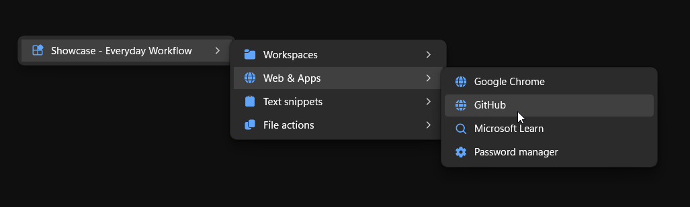
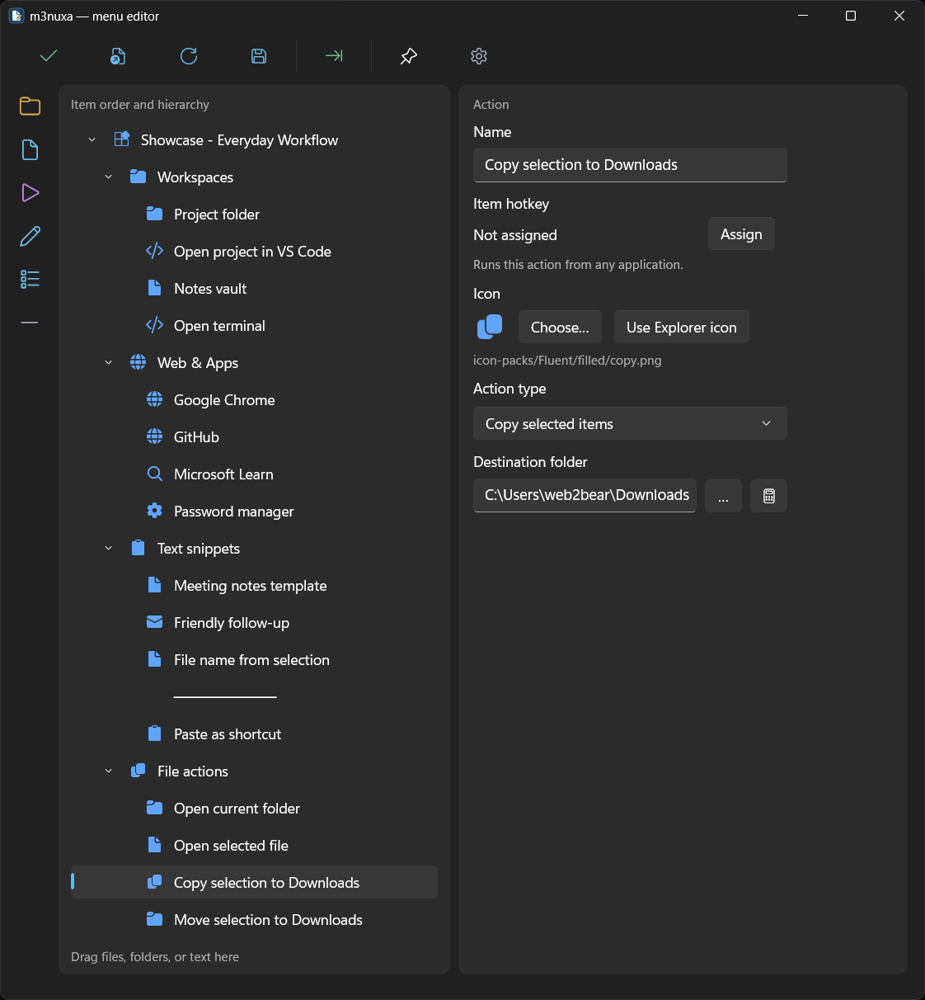
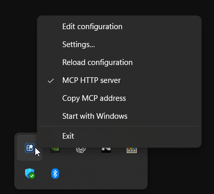

# m3nuxa

### Your workflow. One shortcut away.

A personal command menu for Windows 11. Bring your apps, project folders, scripts, and text snippets together — right where you're working.

**[Download for Windows](https://github.com/web2bear/m3nuxa/releases)** · [Quick start](#get-started-in-minutes) · [User guide](docs/USER_GUIDE.md) · [Русский](docs/README-RU.md)

Windows 11 · Portable · English & Russian · Native Windows interface

## Less searching. More doing.

Open your project folder. Launch your editor. Paste a meeting template. Send selected files to their destination. Put the actions you repeat into a menu that follows your workflow.

Press **Ctrl+Alt+Space** to open your menu at the cursor, or click the tray icon. Use nested groups to keep a growing collection easy to navigate. Give an action its own hotkey for direct access, or assign one to a group to open just that part of your menu.

## A home for your everyday actions

- **Launch your workspace.** Keep project folders, apps, websites, and scripts together. Set arguments and working directories for the tools you use.
- **Make repeated typing effortless.** Insert ready-to-use replies, meeting notes, and other text snippets into the window you were using.
- **Work with the files you selected.** Copy or move files from Explorer to a chosen destination, with progress, cancellation, and file-conflict handling.
- **Keep useful shortcuts close.** Send a keyboard shortcut to the source application from a named menu action.
- **Use the context you already have.** Build actions around the current Explorer folder, selected file path, file name, or parent folder.

## Build a menu that feels like yours

The visual editor puts your menu tree and the selected item's settings side by side. Add groups, actions, snippets, and separators; drag items into place; choose icons that make each command easy to recognize.

Drag supported files, folders, or shortcuts into the tree to create actions. Import items from your desktop to get started faster. Changes stay in a draft until you click **Apply**, and a backup is created before the saved configuration is replaced.

**Try a few useful collections:**

- **Project workspace** — source folder, code editor, terminal, and documentation.
- **Writing toolkit** — reusable replies, meeting templates, and text shortcuts.
- **File workflow** — common destinations and actions for selected Explorer items.

## Quietly available from the tray

Open the editor, reload your configuration, change settings, or enable startup with Windows from the tray menu. Customize the menu hotkey, font size, and interface language in settings.

  

## Let your AI assistant help organize it

m3nuxa includes a local **MCP server**. A compatible assistant can read your menu, prepare a separate draft, create or rearrange items, validate the result, and apply changes with a backup.

Describe the workflow you want — for example, “Create a group for my project with its folder, editor, documentation, and a meeting-notes snippet.” Your assistant can turn that request into editable menu items.

[Connect an assistant through MCP →](docs/MCP.md)

## Get started in minutes

1. **[Download a portable build from Releases](https://github.com/web2bear/m3nuxa/releases)** and extract the entire archive into a writable folder.
2. Run **m3nuxa.App.exe**. Keep the editor and the other supplied files alongside it.
3. Right-click the tray icon and choose **Edit configuration**. Add a few actions, then click **Apply**.
4. Press **Ctrl+Alt+Space** and make it your own.

The self-contained portable build does not require a separate .NET installation. Keep the whole folder when moving it: the menu tree and application settings are stored together in the configuration file. Paths to external apps and folders must still be valid on the destination computer.

> **Preview software:** check the release notes for the build you download. The screenshots show the current development interface; an earlier release may look different.

## Details & documentation

**Requirements:** Windows 11. The interface is available in English and Russian. The default portable build targets x64; source publishing also supports x86 and ARM64.

**Current scope:** predefined text insertion is supported. Reading selected text from other applications is not implemented; templates that depend on `selectedText` are not available. Explorer selection and returning focus to another application depend on the Windows environment.

**Build from source:** install the .NET 10 SDK and the Windows/WinUI build prerequisites, then run `./publish-portable.ps1` from the repository root. Save editor changes first: the script stops running instances, publishes both components, and starts the tray app. See the development guide for checks and diagnostics.

- [User guide: editing, hotkeys, and settings](docs/USER_GUIDE.md)
- [MCP setup and supported tools](docs/MCP.md)
- [Development, debugging, and checks](docs/DEVELOPMENT.md)
- [Included icons and attribution](docs/ICON_PACKS.md)
- [Previous README and detailed setup in Russian](docs/README-RU.md)
- [Domain terminology](docs/CONTEXT.md) · [Requirements](docs/REQUIREMENTS.md) · [Product decisions](docs/PRODUCT_DISCOVERY.md)

Most detailed project documentation is currently in Russian. Requirements and research notes record decisions at the time they were written; the current implementation and release notes define what a particular build supports.
