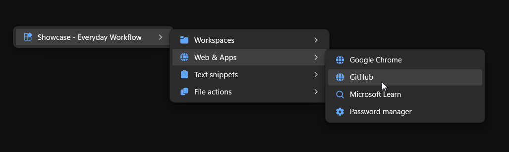
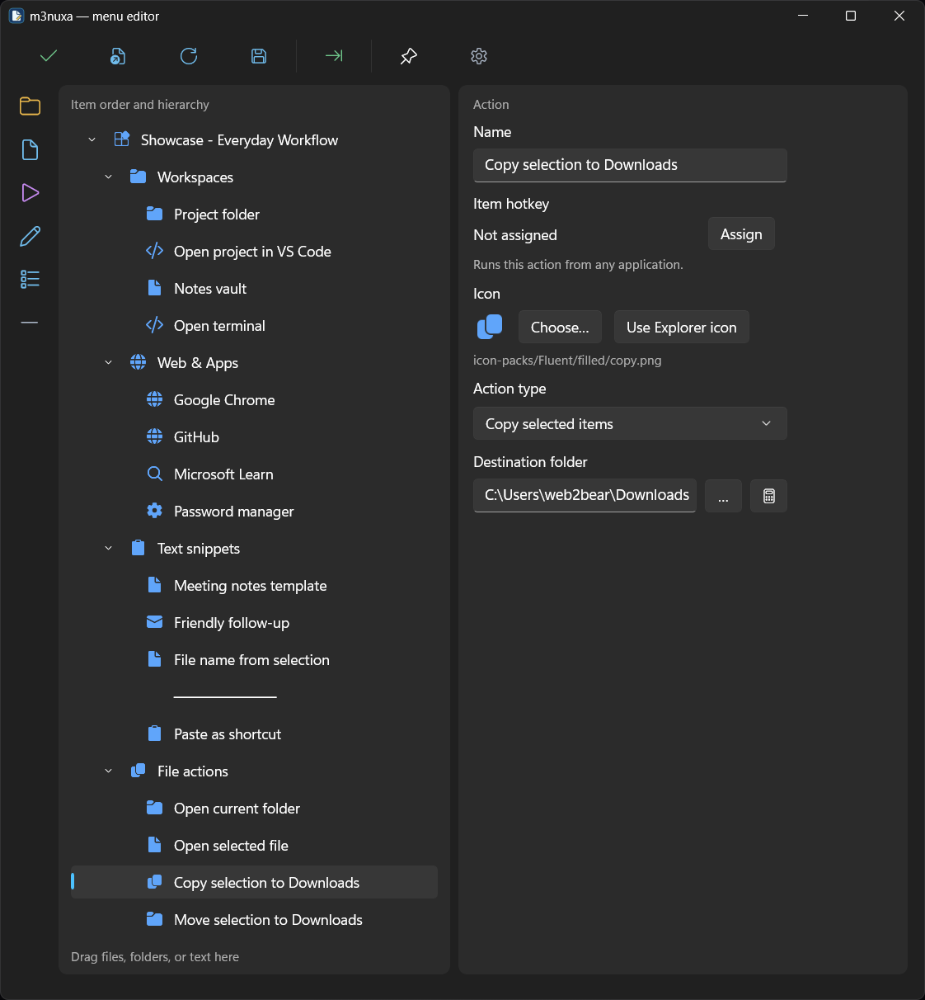
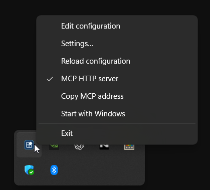

# m3nuxa

### Your workflow. One shortcut away.

A personal command menu for Windows 11. Bring your apps, project folders, scripts, and text snippets together — right where you're working.

**[Download for Windows](https://github.com/web2bear/m3nuxa/releases)** · [Quick start](#get-started-in-minutes) · [User guide](docs/USER_GUIDE.md) · [Русский](docs/README-RU.md)

Windows 11 · Portable · English & Russian · Native Windows interface

## Less searching. More doing.

Open your project folder. Launch your editor. Paste a meeting template. Send selected files to their destination. Put the actions you repeat into a menu that follows your workflow.

Press **Ctrl+Alt+Space** to open your menu at the cursor. Left-click the tray icon to open the editor. Use nested groups to keep a growing collection easy to navigate. Give an action its own hotkey for direct access, or assign one to a group to open just that part of your menu.

Prefer a grid? Assign a separate shortcut to the launcher panel in the configuration settings. It shows the same tree, opens at the center of the pointer's monitor or near the pointer, and supports navigation through groups. The panel has no default shortcut and does not currently have search.

## A home for your everyday actions

- **Launch your workspace.** Keep project folders, apps, websites, and scripts together. Set arguments and working directories for the tools you use.
- **Make repeated typing effortless.** Insert ready-to-use replies, meeting notes, and other text snippets into the window you were using.
- **Work with the files you selected.** Copy or move files from Explorer to a chosen destination, with progress, cancellation, and file-conflict handling.
- **Keep useful shortcuts close.** Send a keyboard shortcut to the source application from a named menu action.
- **Use the context you already have.** Build actions around the current Explorer folder, selected file path, file name, or parent folder.
- **Chain steps.** Combine actions in order, add delays or wait for a program to finish, and stop the sequence if a step fails. Clipboard operations and context variables can connect the steps.

## Build a menu that feels like yours

The visual editor puts your menu tree and the selected item's settings side by side. Use a tree node’s context menu to add groups, actions, snippets, and separators; drag items into place; choose icons that make each command easy to recognize.

Drag files, folders, or shortcuts into the tree to create actions. Import a folder's contents with a preview, choosing whether nested folders become groups or folder-opening actions. Pick a Windows icon, an image, or a colorable Boxicons icon. Changes stay in a draft until you click **Apply**, and a backup is created before the saved configuration is replaced. You can create and switch between multiple menu configurations in the editor.

**Try a few useful collections:**

- **Project workspace** — source folder, code editor, terminal, and documentation.
- **Writing toolkit** — reusable replies, meeting templates, and text shortcuts.
- **File workflow** — common destinations and actions for selected Explorer items.

## Quietly available from the tray

Right-click the tray icon to open the service menu: open the editor or application log, reload the configuration, enable startup with Windows, or manage the MCP server. Customize shortcuts and appearance in configuration settings. Choose the language for both applications from the tray menu; reopen the editor to update its language.

  

## Let your AI assistant help organize it

m3nuxa includes a local **MCP server**, enabled from the tray menu. A compatible assistant can read your menu, prepare a separate draft, create or rearrange items, validate the result, and apply changes with a backup. The HTTP endpoint listens on the local machine only.

Describe the workflow you want — for example, “Create a group for my project with its folder, editor, documentation, and a meeting-notes snippet.” Your assistant can turn that request into editable menu items.

[Connect an assistant through MCP →](docs/MCP.md)

## Get started in minutes

1. **[Download a portable build from Releases](https://github.com/web2bear/m3nuxa/releases)** and extract the entire archive into a writable folder.
2. Run **m3nuxa.App.exe**. Keep the editor and the other supplied files alongside it.
3. Press **Ctrl+Alt+Space** to open the menu. Left-click the tray icon to open the editor, or right-click it for the service menu.
4. Add or change actions in the editor and click **Apply**.

On a first start with an empty configuration directory, the current source version creates a starter menu with Windows folders, built-in programs, and shortcuts for windows, virtual desktops, screenshots, and clipboard history. It can be edited like any other configuration. Existing configurations are retained when the application is updated; the starter menu is not added to an existing directory automatically. Released builds may differ from the current source version.

Menu configurations are stored in `configs` next to `m3nuxa.App.exe` by default. Stable application-wide settings, including the selected profile, are stored in `m3nuxa.App.config` beside the executable, so changing menu profiles does not change the language, MCP state, or launcher panel geometry. To use another directory for menu configurations, start the application with `--config-dir "C:\path\to\configs"` or set the `M3NUXA_CONFIG_DIR` environment variable. The command-line option takes precedence.

The self-contained portable build does not require a separate .NET installation. Keep the whole folder when moving it: application settings sit beside the executable, and menu configurations are stored in the configuration directory. Paths to external apps and folders must still be valid on the destination computer.

> **Preview software:** check the release notes for the build you download. Screenshots are illustrative and may not reflect the current interface.

## Details & documentation

**Requirements:** Windows 11. The interface is available in English and Russian. The default portable build targets x64; source publishing also supports x86 and ARM64.

**Current scope:** predefined text insertion is supported. Reading selected text from other applications is not implemented; templates that depend on `selectedText` are not available. Explorer selection and returning focus to another application depend on the Windows environment.

**Build from source:** install the .NET 10 SDK and the Windows/WinUI build prerequisites, then run `./publish-local.ps1` from the repository root. It publishes both components to `dist/m3nuxa`, stops running App and Editor processes, and starts the tray app. Save editor changes first. A shortcut to `dist/m3nuxa/m3nuxa.App.exe` keeps working when the script is rerun, provided the repository and output folder stay in place. See the development guide for architecture options, checks, and diagnostics.

- [User guide: editing, hotkeys, and settings](docs/USER_GUIDE.md)
- [MCP setup and supported tools](docs/MCP.md)
- [Development, debugging, and checks](docs/DEVELOPMENT.md)
- [Included icons and attribution](docs/ICON_PACKS.md)
- [Полное описание и установка на русском](docs/README-RU.md)
- [Current scenarios and non-functional requirements](docs/REQUIREMENTS.md)
- [Domain terminology](docs/CONTEXT.md) · [Product decision history](docs/PRODUCT_DISCOVERY.md)

The requirements document describes the current product contract. Product discovery and research documents preserve historical context and are not current implementation status reports.
